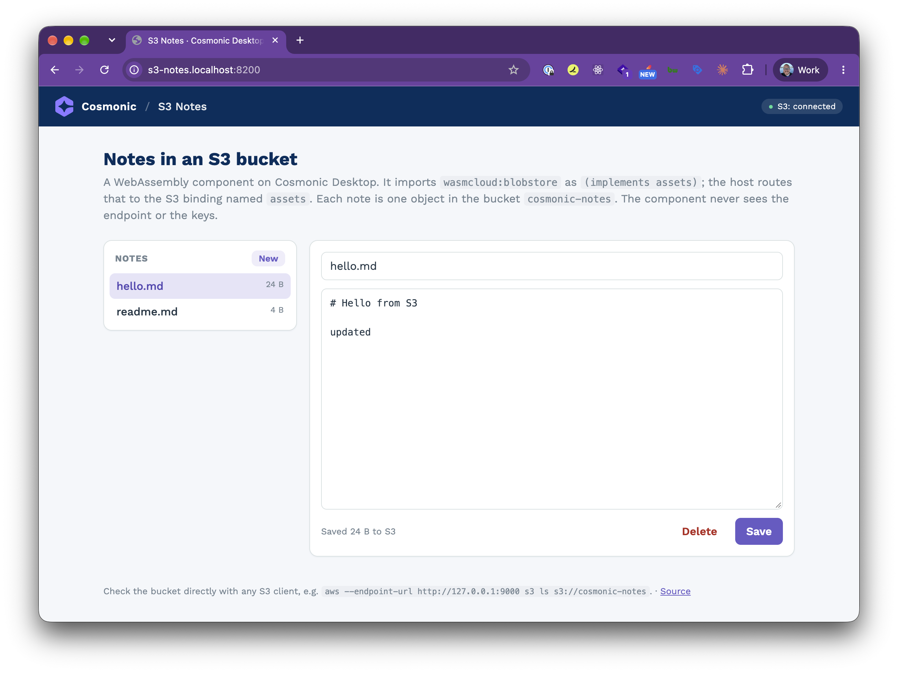

# S3 Notes for Cosmonic Desktop

A small WebAssembly component that keeps notes as objects in an **S3 bucket**,
using [wasmCloud's S3 blobstore backend](https://wasmcloud.com/docs/kubernetes-operator/host-interface-configuration/#backend-s3)
as configured in [Cosmonic Desktop](https://cosmonic.com). It works with AWS S3
or any S3-compatible server; the sample uses SeaweedFS.



The component imports `wasmcloud:blobstore` under `(implements ..)` labels:

```wit
world s3-notes {
    import assets: wasmcloud:blobstore/blobstore@0.1.0;
    import assets-objects: wasmcloud:blobstore/container@0.1.0;
    export wasi:http/handler@0.3.0;
}
```

Cosmonic Desktop routes `assets` to the **S3 binding named `assets`**
(Settings → Built-in plugins → S3). The binding holds the endpoint and keys,
and the component never sees them.

WIT allows one interface per label, so the object methods (`container`) take a
second label, `assets-objects`. A container opened through `assets` keeps the
S3 backend whichever label its methods arrive through, so `assets-objects`
needs no binding of its own.

## Run it

You need Cosmonic Desktop with Redis/S3 bindings (0.5.33 or newer), Docker,
Rust with the `wasm32-wasip2` target, and [`wash`](https://wasmcloud.com/docs/installation).

1. **Start S3.** The script runs SeaweedFS on loopback, with demo
   credentials and the `cosmonic-notes` bucket:

   ```sh
   scripts/start-s3.sh             # http://127.0.0.1:9000, bucket cosmonic-notes
   ```

   It prints the access key ID and secret access key. Override them with
   `S3_ACCESS_KEY` / `S3_SECRET_KEY`.

2. **Store the keys as two secrets** in Cosmonic Desktop, one per value, on
   the Secrets screen. For example, `s3-access-key` = `cosmonic-demo` and
   `s3-secret-key` = `cosmonic-demo-secret`. The target key doesn't matter
   for a binding.

3. **Add the binding**: Settings → Built-in plugins → S3 → *Add binding*.
   - Binding name: `assets`
   - Endpoint: `http://127.0.0.1:9000`
   - Region: `us-east-1`
   - **Allow plain HTTP**: on
   - Credentials: *Access key*, with the two secrets from step 2

   Then click **Restart host**.

4. **Build and push** the component to Desktop's built-in registry:

   ```sh
   scripts/build.sh                # -> oci.localhost:8200/apps/desktop-s3-notes:0.2.0
   ```

5. **Deploy** `workload.yaml`: paste it into Workloads, or ask your coding
   agent to apply it with the Cosmonic MCP tools.

6. **Open <http://s3-notes.localhost:8200/>.** Write a note and save it. It
   is now an object in the bucket:

   ```sh
   curl --user cosmonic-demo:cosmonic-demo-secret --aws-sigv4 "aws:amz:us-east-1:s3" \
     http://127.0.0.1:9000/cosmonic-notes/
   ```

## API

| Method | Path | |
| --- | --- | --- |
| `GET` | `/api/notes` | `{"bucket","notes":[{"name","size"}]}` |
| `GET` | `/api/notes/<name>` | the note's text |
| `PUT` | `/api/notes/<name>` | store the request body (up to 1 MiB) |
| `DELETE` | `/api/notes/<name>` | delete the note |

Note names are letters, digits, `-`, `_` and `.`.

## What the host enforces

The workload names only the binding. Cosmonic Desktop refuses a manifest that
sets any S3 key itself (`endpoint`, `region`, credentials, ...). It also
refuses one that names a binding the host doesn't declare.

The S3 backend doesn't create buckets. `cosmonic-notes` must exist (the start
script creates it). Each container a component opens is one bucket.

## Notes

- **`scripts/build.sh` needs `wasm-component-ld` 0.5.30 or newer.** The linker
  bundled with older Rust toolchains rejects `(implements ..)` import names.
  The script installs a newer one with `cargo install` if none is on your
  `PATH`.
- **Stop S3** with `scripts/stop-s3.sh`.

## License

Apache-2.0
